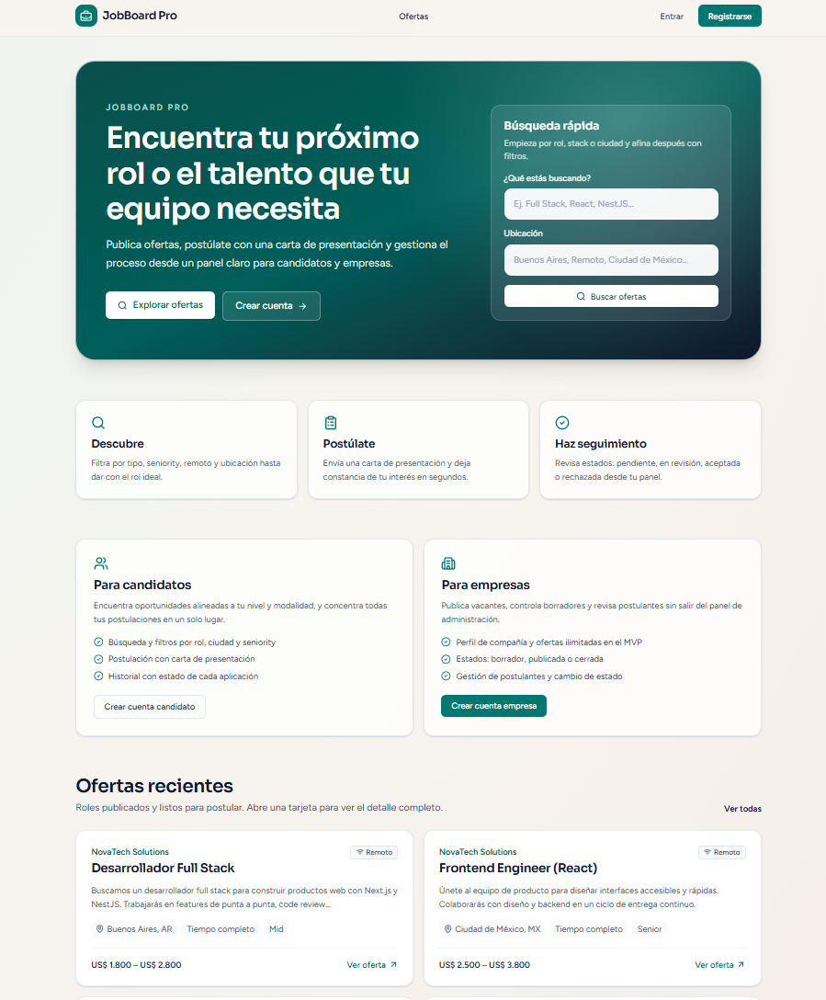
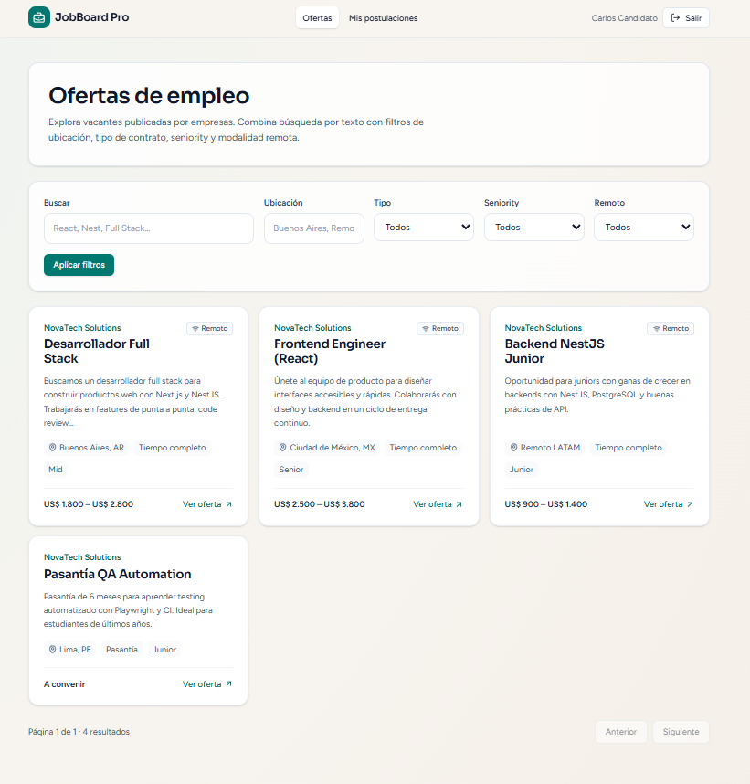
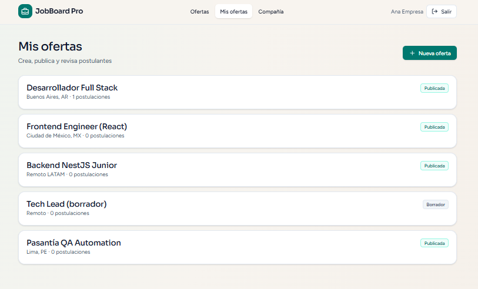
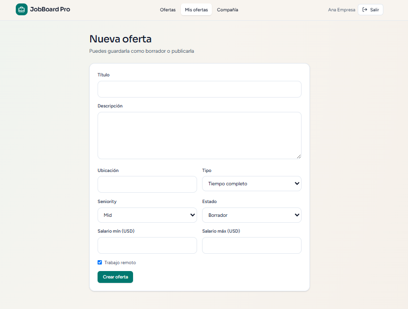

# JobBoard Pro

Portal de empleos full-stack con dos roles: **empresas** que publican ofertas y gestionan a sus postulantes, y **candidatos** que buscan, filtran y se postulan con una carta de presentación. Monorepo con frontend en **Next.js 15**, API REST en **NestJS 11** y **PostgreSQL** con **Prisma**, autenticación JWT con renovación automática de sesión y API documentada con Swagger.



## Funcionalidades

**Para el candidato**

- Listado público de ofertas con búsqueda por texto (título, descripción o empresa) y filtros por ubicación, tipo de contrato, seniority y modalidad remota, con paginación.
- Detalle de cada oferta con la información de la empresa.
- Postulación con carta de presentación opcional (hasta 2000 caracteres); solo una postulación por oferta.
- Panel **Mis postulaciones** con el estado de cada una: pendiente, en revisión, aceptada o rechazada.

**Para la empresa**

- Perfil de la compañía (nombre, descripción y sitio web), requisito previo para publicar.
- Creación, edición y eliminación de ofertas, con estados **borrador**, **publicada** o **cerrada**. Los borradores no aparecen en el listado público.
- Panel **Mis ofertas** con el número de postulaciones de cada oferta.
- Revisión de postulantes de cada oferta (nombre, email y carta) y cambio de estado de cada postulación.

| Ofertas con filtros (sesión de candidato)                                   | Panel de la empresa: mis ofertas                                      |
| --------------------------------------------------------------------------- | --------------------------------------------------------------------- |
|    |  |

| Nueva oferta (borrador o publicada)                       |
| --------------------------------------------------------- |
|  |

## Stack

| Capa          | Tecnología                                                                          |
| ------------- | ----------------------------------------------------------------------------------- |
| Frontend      | Next.js 15 (App Router), React 19, TypeScript, Tailwind CSS 4, lucide-react         |
| Backend       | NestJS 11, Passport JWT, bcrypt, class-validator / class-transformer               |
| Base de datos | PostgreSQL 16, Prisma 6 (schema, migraciones y seed)                                |
| Documentación | Swagger (OpenAPI) con `@nestjs/swagger`                                             |
| Monorepo      | pnpm workspaces: `apps/web`, `apps/api` y `packages/shared`                         |
| Entorno       | Docker Compose para PostgreSQL                                                      |

## Decisiones técnicas

### JWT con access y refresh token, y renovación transparente en el cliente

Al iniciar sesión o registrarse, la API firma **dos tokens con secretos distintos** (`JWT_ACCESS_SECRET` y `JWT_REFRESH_SECRET`): un access token de vida corta (15 minutos por defecto) y un refresh token de 7 días, ambos configurables por variables de entorno. Las contraseñas se guardan con **bcrypt** y el email se normaliza a minúsculas tanto al registrar como al iniciar sesión. Si el email o la contraseña no coinciden, la respuesta es el mismo mensaje genérico ("Credenciales inválidas"), para no revelar si la cuenta existe.

En el frontend, todas las peticiones pasan por un único cliente HTTP (`apps/web/src/lib/api.ts`). Si la API responde `401`, el cliente llama a `POST /auth/refresh`, guarda los tokens nuevos y **reintenta la petición original una vez**, sin que el usuario lo note. Si el refresh también falla, limpia la sesión. El mismo cliente unifica los errores: los mensajes de validación de NestJS (que llegan como arreglo) se convierten en un solo texto para mostrar en la interfaz.

### Rutas protegidas con el middleware de Next.js

Los tokens se guardan en cookies para que el **middleware de Next.js** pueda leerlos antes de renderizar. Cualquier ruta bajo `/dashboard/*` sin sesión redirige a `/login?next=<ruta>`, y después del login el usuario vuelve a donde iba. Dentro del panel, cada página revisa el rol y redirige al panel que corresponde (empresa → `/dashboard/jobs`, candidato → `/dashboard/applications`). Esto es solo experiencia de usuario: la autorización real se aplica en la API.

### Autorización en dos niveles: rol y propiedad del recurso

- **Rol:** un decorador `@Roles(...)` guarda metadatos que lee `RolesGuard` (con `Reflector`, a nivel de método o de controlador). Un candidato que intenta crear una oferta recibe `403`. El registro solo acepta `CANDIDATE` o `EMPLOYER`: el DTO lo valida con `@IsIn` y el servicio rechaza explícitamente `ADMIN`.
- **Propiedad:** que el usuario sea empresa no basta. Los servicios comprueban que la oferta pertenezca a **su** compañía antes de leerla en modo gestión, editarla, borrarla, listar sus postulantes o cambiar el estado de una postulación. `JobsService.findOneForOwner` se reutiliza en `update` y `remove`, así que la regla vive en un solo lugar. Una empresa que pide la oferta de otra recibe `403`.
- **Visibilidad pública:** los endpoints públicos solo devuelven ofertas `PUBLISHED`; un borrador consultado por id responde `404`, y no se puede postular a una oferta que no esté publicada.

### Una postulación por oferta, garantizado por la base de datos

`Application` tiene una restricción única compuesta `@@unique([jobId, candidateId])`. El servicio consulta primero por esa clave compuesta y responde `409 Conflict` con un mensaje claro ("Ya te postulaste a esta oferta"); la restricción en PostgreSQL asegura que, aunque la verificación de la aplicación se saltara, nunca existan dos postulaciones del mismo candidato a la misma oferta.

### Modelo de datos con Prisma

- `User` 1:1 `Company` (`ownerId` es único), `Company` 1:N `Job`, `Job` 1:N `Application` y `User` 1:N `Application`.
- IDs con `cuid()` (no secuenciales, no revelan el volumen de datos) y borrado en cascada de compañía → ofertas → postulaciones.
- Índices en las columnas por las que se filtra (`status`, `type`, `seniority`, `location`) y en las claves foráneas de `Application` (`jobId`, `candidateId`).
- Enums de PostgreSQL para rol, tipo de contrato, seniority y estados de oferta y postulación.
- Si una empresa intenta publicar sin haber creado su compañía, la API responde `409` con "Primero debes crear el perfil de tu compañía".

### Búsqueda y paginación en el servidor

`GET /api/jobs` arma un único `where` de Prisma a partir de los filtros: la búsqueda libre (`q`) cubre título, descripción y nombre de la empresa sin distinguir mayúsculas, y se combina con ubicación, tipo, seniority y modalidad remota. La página de resultados y el total se consultan **en paralelo** (`findMany` + `count` con `Promise.all`), y la respuesta incluye `meta` con `total`, `page`, `limit` y `totalPages`. El `limit` tiene un tope de 50 para que nadie pida la tabla completa. En el frontend, los filtros viven en la URL (`?q=&type=&page=`), así que una búsqueda se puede compartir o recargar.

### Validación estricta y documentación generada desde los DTOs

El `ValidationPipe` global usa `whitelist` y `forbidNonWhitelisted`: cualquier campo que no esté declarado en el DTO se rechaza con `400` (por ejemplo, un candidato no puede colar `status: "ACCEPTED"` al postularse). Con `transform`, parámetros como `page` y `limit` llegan convertidos a número. Los mismos DTOs llevan decoradores `@ApiProperty`, así que **Swagger se genera desde el código** e incluye autenticación Bearer para probar los endpoints protegidos desde `/api/docs`.

### Otros detalles

- `packages/shared` define los enums y sus **etiquetas en español** ("Tiempo completo", "En revisión"…), que el frontend consume directamente con `transpilePackages`.
- La portada es un Server Component que obtiene las ofertas recientes en el servidor con `revalidate: 30`, así que no consulta la API en cada visita.
- CORS configurable por `CORS_ORIGIN` (admite varios orígenes separados por coma).

## Puesta en marcha

Requisitos: Node.js 20+, pnpm 10+ y Docker Desktop.

> **Nota:** el PostgreSQL del proyecto se publica en el puerto **5433** del host, para no chocar con un PostgreSQL local en el 5432. `DATABASE_URL` en `apps/api/.env.example` ya apunta a ese puerto.

```bash
git clone https://github.com/nnvaldev/JobBoard.git
cd JobBoard

# 1) Variables de entorno
cp apps/api/.env.example apps/api/.env
cp apps/web/.env.example apps/web/.env.local

# 2) Dependencias
pnpm install

# 3) Base de datos
docker compose up -d

# 4) Paquete compartido + cliente Prisma + migraciones + seed
pnpm --filter @jobboard/shared build
pnpm db:generate
pnpm --filter @jobboard/api exec prisma migrate dev
pnpm db:seed

# 5) Desarrollo (API :3001 + Web :3000)
pnpm dev
```

También se pueden levantar por separado con `pnpm dev:api` y `pnpm dev:web`.

| Servicio | URL                            |
| -------- | ------------------------------ |
| Web      | http://localhost:3000          |
| API      | http://localhost:3001/api      |
| Swagger  | http://localhost:3001/api/docs |

### Cuentas de demo

El seed crea la compañía **NovaTech Solutions** con 4 ofertas publicadas y 1 borrador, y una postulación del candidato a "Desarrollador Full Stack".

| Rol                              | Email                | Contraseña |
| -------------------------------- | -------------------- | ---------- |
| Empresa (Ana Empresa, NovaTech)  | `empresa@demo.com`   | `demo1234` |
| Candidato (Carlos Candidato)     | `candidato@demo.com` | `demo1234` |

**Recorrido sugerido:**

1. Entra como **empresa** y revisa tus ofertas en `/dashboard/jobs`.
2. Entra como **candidato** y postúlate a una oferta desde `/jobs`.
3. Vuelve como empresa, abre la oferta y cambia el estado de la postulación.
4. Como candidato, revisa el estado actualizado en `/dashboard/applications`.

## API

Documentación interactiva en **http://localhost:3001/api/docs**. Todas las rutas llevan el prefijo `/api`.

| Método   | Ruta                         | Acceso              | Descripción                                          |
| -------- | ---------------------------- | ------------------- | ---------------------------------------------------- |
| `POST`   | `/auth/register`             | Público             | Registro como candidato o empresa                    |
| `POST`   | `/auth/login`                | Público             | Devuelve access token, refresh token y usuario       |
| `POST`   | `/auth/refresh`              | Público             | Nuevo par de tokens a partir del refresh token       |
| `GET`    | `/auth/me`                   | Autenticado         | Usuario actual (con su compañía, si tiene)           |
| `PATCH`  | `/users/me`                  | Autenticado         | Actualizar nombre                                    |
| `GET`    | `/jobs`                      | Público             | Ofertas publicadas con filtros y paginación          |
| `GET`    | `/jobs/:id`                  | Público             | Detalle de una oferta publicada                      |
| `GET`    | `/companies/me`              | Empresa             | Perfil de mi compañía                                |
| `PUT`    | `/companies/me`              | Empresa             | Crear o actualizar mi compañía                       |
| `GET`    | `/jobs/mine`                 | Empresa             | Mis ofertas con conteo de postulaciones              |
| `GET`    | `/jobs/:id/manage`           | Empresa (dueña)     | Oferta en modo gestión (incluye borradores)          |
| `POST`   | `/jobs`                      | Empresa             | Crear oferta                                         |
| `PATCH`  | `/jobs/:id`                  | Empresa (dueña)     | Editar oferta o cambiar su estado                    |
| `DELETE` | `/jobs/:id`                  | Empresa (dueña)     | Eliminar oferta                                      |
| `GET`    | `/jobs/:id/applications`     | Empresa (dueña)     | Postulantes de una oferta                            |
| `PATCH`  | `/applications/:id/status`   | Empresa (dueña)     | Cambiar estado de una postulación                    |
| `POST`   | `/jobs/:id/applications`     | Candidato           | Postularse (`409` si ya se postuló)                  |
| `GET`    | `/applications/me`           | Candidato           | Mis postulaciones con su estado                      |

Filtros de `GET /jobs`: `q`, `location`, `type` (`FULL_TIME`, `PART_TIME`, `CONTRACT`, `INTERNSHIP`), `seniority` (`JUNIOR`, `MID`, `SENIOR`, `LEAD`), `isRemote`, `page` y `limit` (máximo 50).

## Estructura

```
jobboard-pro/
├── apps/
│   ├── api/                          API NestJS
│   │   ├── prisma/
│   │   │   ├── schema.prisma         modelo de datos, enums e índices
│   │   │   ├── migrations/
│   │   │   └── seed.ts               datos y cuentas de demo
│   │   └── src/
│   │       ├── auth/                 registro, login, refresh, estrategia JWT
│   │       ├── common/               guards (JWT, roles) y decoradores (@Roles, @CurrentUser)
│   │       ├── companies/            perfil de compañía
│   │       ├── jobs/                 ofertas: listado público, búsqueda y gestión
│   │       ├── applications/         postulaciones y cambio de estado
│   │       ├── users/
│   │       ├── prisma/               PrismaService
│   │       └── main.ts               prefijo /api, CORS, ValidationPipe y Swagger
│   └── web/                          Frontend Next.js
│       └── src/
│           ├── app/                  portada, /jobs, /login, /register y /dashboard
│           ├── components/           AuthProvider, navbar, tarjeta de oferta, UI
│           ├── lib/api.ts            cliente HTTP con refresh automático
│           └── middleware.ts         protección de /dashboard
├── packages/shared/                  enums y etiquetas en español compartidos
└── docker-compose.yml                PostgreSQL 16 (puerto 5433 en el host)
```

## Próximos pasos

- [ ] Tests de integración de la API (autorización por rol y propiedad, postulación duplicada).
- [ ] Rotación y revocación de refresh tokens guardados en la base de datos.
- [ ] Tokens en cookies `httpOnly` emitidas por la API.
- [ ] Validar que `salaryMin` no supere `salaryMax`.
- [ ] Deploy con demo en vivo.

---

Desarrollado por **Alexander Castillo** ([@nnvaldev](https://github.com/nnvaldev)) · La Paz, Bolivia.
